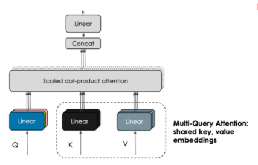
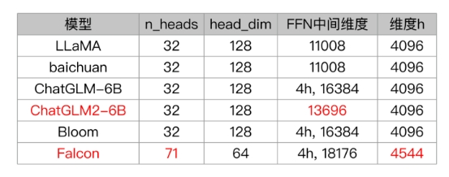
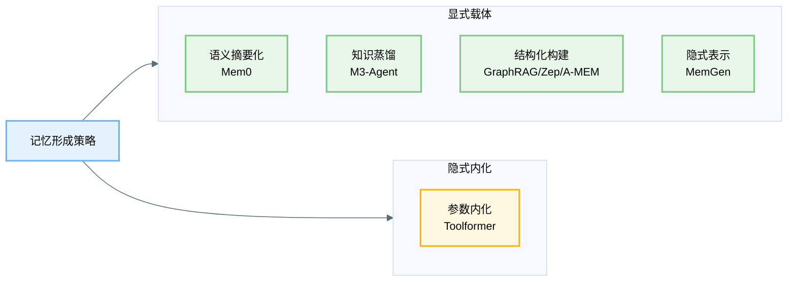

# 大模型（LLMs）基础面：Attention 升级面

**大模型面试宝典**

**AIGC / 大模型 / AI Agent 算法岗 · 1000+ 高频面试考点**

[👉 github.com/km1994/AIGC-Interview-Book](https://github.com/km1994/AIGC-Interview-Book)

- [大模型（LLMs）基础面：Attention 升级面](#大模型llms基础面attention-升级面)
  - [4 Multi-Query Attention 篇](#4-multi-query-attention-篇)
    - [4.1 Multi-head Attention 存在什么问题？](#41-multi-head-attention-存在什么问题)
    - [4.2 介绍一下 Multi-Query Attention？](#42-介绍一下-multi-query-attention)
    - [4.3 对比一下 Multi-head Attention 和 Multi-Query Attention？](#43-对比一下-multi-head-attention-和-multi-query-attention)
    - [4.4 Multi-Query Attention 这样做的好处是什么？](#44-multi-query-attention-这样做的好处是什么)
    - [4.5 有 哪些模型 是 使用 Multi-Query Attention？](#45-有-哪些模型-是-使用-multi-query-attention)
  - [什么是 FFN前馈神经网络？](#什么是-ffn前馈神经网络)
    - [LLMs 各模型分别用了 哪种 Layer normalization？](#llms-各模型分别用了-哪种-layer-normalization)

## 4 Multi-Query Attention 篇

### 4.1 Multi-head Attention 存在什么问题？

- **训练过程**：不会显著影响训练过程，训练速度不变，会引起非常细微的模型效果损失；
- **推理过程**：反复加载 巨大 的 KV cache , 导致 内存开销大，性能是内存受限；

### 4.2 介绍一下 Multi-Query Attention？

Multi-QueryAttention(MQA)：19年提出的一种新的 注意力 机制，是MHA的变体形式，**K，V只有一个头，Q是多头，通过共享K得到注意力得分**。

### 4.3 对比一下 Multi-head Attention 和 Multi-Query Attention？

- Multi-head Attention：每个注意力头都有各自的query、key和value。
- Multi-query Attention: 在所有的注意力头上共享key和value。

Falcon、PaLM、ChatGLM2-6B都使用了Multi-query Attention，但有细微差别。

- 为了保持参数量一致，
  - Falcon: 把隐藏维度从4096增大到了4544。多余的参数量分给了Attention块和FFN块
  - ChatGLM2: 把FFN中间维度从11008增大到了13696。多余的参数分给了FFN块

### 4.4 Multi-Query Attention 这样做的好处是什么？

减少 KV cache 的大小，减少显存占用，提升推理速度。

### 4.5 有 哪些模型 是 使用 Multi-Query Attention？

- 代表模型：PaLM、ChatGLM2、Falcon等

## 什么是 FFN前馈神经网络？

- 介绍：处理来自Attention层的信息；在原始的Transformer模型中，FFN层通常由两个线性变换和一个非线性激活函数（如ReLU或GELU）组成。

$$
\mathrm{FFN}(x) = \mathrm{GELU}(xW_1 + b_1)\,W_2 + b_2
$$

- 其中 $W_1 \in \mathbb{R}^{d_{\text{model}} \times d_{ff}}$、$W_2 \in \mathbb{R}^{d_{ff} \times d_{\text{model}}}$，原始 Transformer 取 $d_{ff} = 4\,d_{\text{model}}$；FFN 对序列中每个位置（position-wise）独立作用，位置之间不交互。

### LLMs 各模型分别用了 哪种 Layer normalization？

BLOOM在embedding层后添加layer normalization，有利于提升训练稳定性:但可能会带来很大的性能损失

| 度量 | 用在什么上 | 坑 |
|---|---|---|
| 余弦 / 内积 | 稠密语义向量 | 忽略模长；没归一化时内积偏向长向量 |
| 欧氏距离 L2 | 数值特征、聚类、图像特征 | 各维量纲不同会失真，得先标准化 |
| 曼哈顿 L1 | 稀疏、高维、离群点多 | 对特征缩放敏感 |

你的值 $x$ 和 $y$ = $P_i$

$$
P_i = s + y - z
$$

