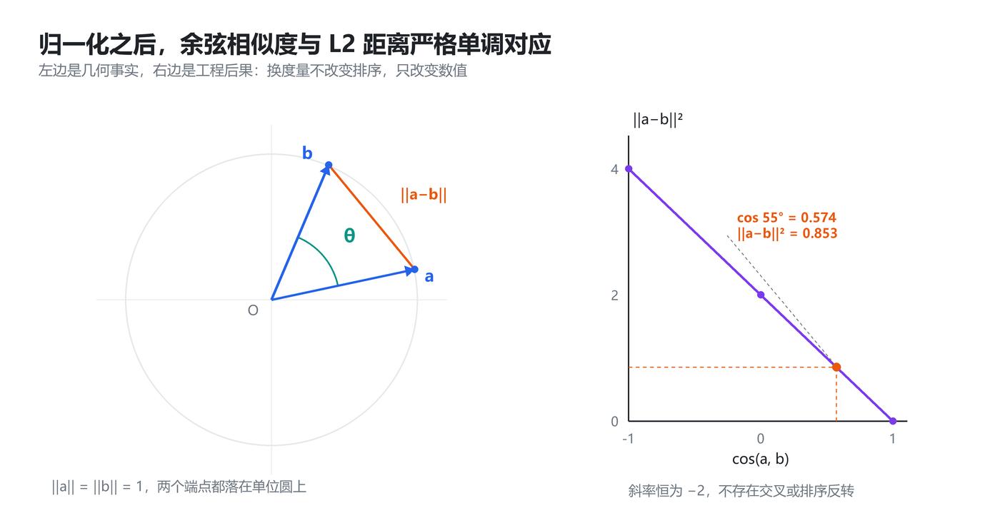
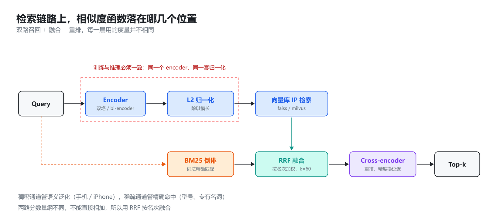
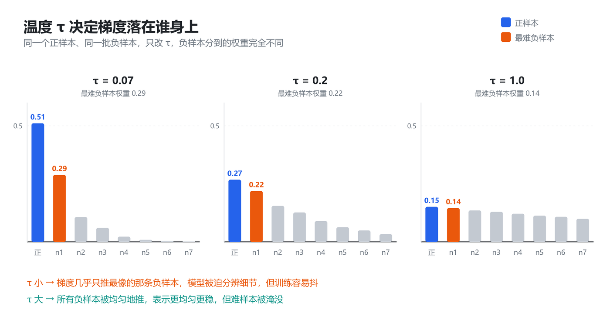
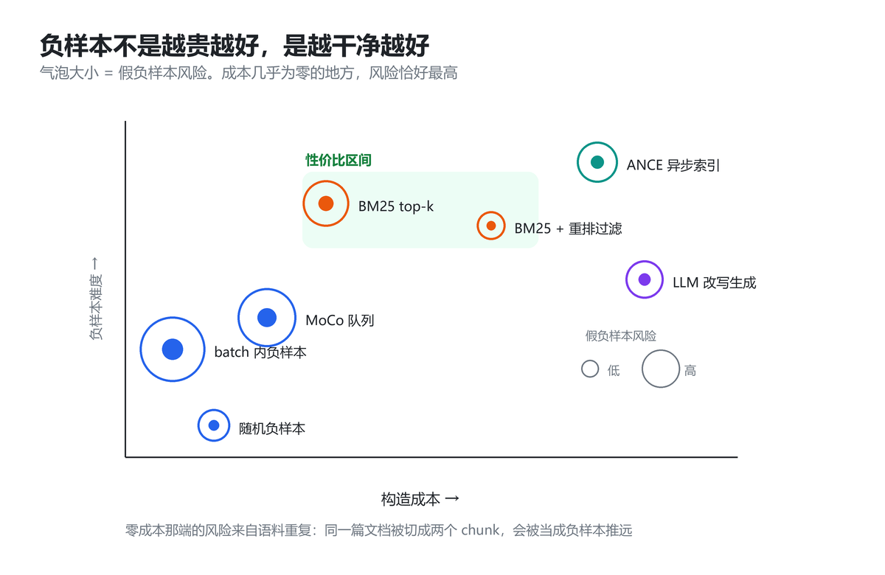

# 大模型（LLMs）基础面：相似度函数面试篇

**大模型面试宝典**

**AIGC / 大模型 / AI Agent 算法岗 · 1000+ 高频面试考点**

[👉 github.com/km1994/AIGC-Interview-Book](https://github.com/km1994/AIGC-Interview-Book)

> 一份按考点组织的大模型面试题库，每题给一句话答案、拆为什么、标出面试官会怎么追问，本文是其中「相似度函数」这一篇。

这三道题在大模型算法面里出现频率极高，属于送分题。但我面的时候发现，十个人里九个只能把名字报一遍，报完就没了。

问题不在记性，在于答成了词典。面试官问"除了 cosine 还有哪些"，他不想听你把距离公式默写一遍，他想知道你在什么场景下会换掉 cosine，换掉之后踩过什么坑。

先把这层捅破，后面就好办了。

## Q1. 除了 cosine，还有哪些算相似度的方法

标准答案那串是：欧氏距离、曼哈顿距离、Jaccard、皮尔逊相关系数。报完这串，面试官一般会沉默两秒，然后问下一题。

我建议你换个答法。

### 三个度量在什么条件下是同一个东西

这是这道题真正的考点，很多人不知道。

先把定义摆出来，别一张嘴就是"算夹角"：

$$
\cos(\mathbf a, \mathbf b)
= \frac{\mathbf a^\top \mathbf b}{\|\mathbf a\|_2 \, \|\mathbf b\|_2}
= \frac{\sum_i a_i b_i}{\sqrt{\sum_i a_i^2}\;\sqrt{\sum_i b_i^2}}
$$

分子是内积，分母是两个模长。向量各分量同乘一个正数 λ，分子涨 λ²，分母也涨 λ²，比值不变。这就是"cosine 只看方向、不看长度"的数学来源。

向量先做 L2 归一化，也就是除以模长，那么：

$$
\|\mathbf a - \mathbf b\|_2^2
= \|\mathbf a\|_2^2 + \|\mathbf b\|_2^2 - 2\,\mathbf a^\top \mathbf b
= 2 - 2\cos(\mathbf a,\mathbf b)
$$

右边这一步是因为 ‖a‖ = ‖b‖ = 1。所以单位球面上，‖a−b‖² 与 cos 之间是一条斜率恒为 −2 的直线，不存在任何交叉或排序反转。

图 1 · 左边是几何事实，右边是它带来的工程后果：换度量不改变排序，只改变数值。

换句话说，距离最近的那个，余弦也是最大的。所以你说"用 L2"还是"用 cosine"，在归一化之后是同一件事，只是排序的数值不同。

内积和余弦的关系更直接：归一化之后内积就等于余弦。这也是为什么 FAISS 里做语义检索，大家写的是 `IndexFlatIP`，不是 cosine index，因为 faiss 压根没给你 cosine 这个 index type，它给的是内积，你自己归一化。

面试时把这一层说出来，性质就变了。你不是在背清单，你在说"这三者在我眼里是一个东西的三个坐标"。

顺带一个区分：皮尔逊相关系数等于去均值之后的余弦。Spearman 是皮尔逊套在秩上。这三兄弟的关系能一句话讲明白，面试官会记你一笔。

### cosine 什么时候会失效

这才是有含金量的部分。

cosine 只看方向，不看长度。文本 embedding 里这是优点，长文档不会因为 norm 大就占便宜。但如果长度本身带信息，cosine 就把信息丢了。推荐场景里用户向量的模长经常编码活跃度，电商里商品向量的模长编码热度，这时候你用 cosine，等于主动把强特征抹平。

第二个失效点：cosine 要求两边在同一个语义空间。拿一个中文 BERT 提的向量去和英文 CLIP 提的向量算余弦，算出来的数没有任何意义，哪怕它落在 0.7 看起来很像。跨模型、跨版本、跨模态的向量不能直接比，这是线上最容易出的事故。

第三：余弦对稀疏高维向量不友好。词袋级别的匹配，两个文档共享 3 个词和共享 30 个词，在一万维空间里余弦值都很小，区分度被维度稀释。这种场景该上 Jaccard 或 BM25。

### 一张表，够用

| 度量 | 用在什么上 | 坑 |
|---|---|---|
| 余弦 / 内积 | 稠密语义向量 | 忽略模长；没归一化时内积偏向长向量 |
| 欧氏距离 L2 | 数值特征、聚类、图像特征 | 各维量纲不同会失真，得先标准化 |
| 曼哈顿 L1 | 稀疏、高维、离群点多 | 对特征缩放敏感 |
| Jaccard | 集合、token 重合、标签集合 | 完全无视频次；空集要单独兜 |
| Dice | 短文本、实体名 | 和 Jaccard 单调等价，别当两种方法讲 |
| 皮尔逊 | 评分、去均值后的线性相关 | 对非线性关系无能 |
| BM25 | 稀疏倒排检索 | 语义零泛化，"手机"搜不到"iPhone" |
| 编辑距离 | 字符串、纠错、实体对齐 | O(nm)，长文本别用 |
| SimHash / MinHash | 海量去重 | 概率性，有假阳假阴 |
| KL / JS 散度 | 分布比较 | KL 不对称、不满足三角不等式，别当距离 |
| Wasserstein | 分布搬土成本、点云 | 求解贵 |

表里几个式子值得写一遍，写不出来说明只是见过名字。

集合类，Jaccard 和 Dice 只差一个分母：

$$
J(A,B) = \frac{|A \cap B|}{|A \cup B|},
\qquad
D(A,B) = \frac{2\,|A \cap B|}{|A| + |B|},
\qquad
J = \frac{D}{2 - D}
$$

最后一个恒等式说明两者单调等价，排序完全一致。面试时说"这两个是两种方法"，说明你没自己推过。

BM25 是稀疏检索的基线，比 TF-IDF 多做了两件事，词频饱和和文档长度惩罚：

$$
\mathrm{score}(q,d) = \sum_{t \in q} \mathrm{IDF}(t) \cdot
\frac{f(t,d)\,(k_1 + 1)}
{f(t,d) + k_1\left(1 - b + b\,\frac{|d|}{\mathrm{avgdl}}\right)}
$$

$k_1$ 控词频饱和（常用 1.2 到 2.0），$b$ 控长度惩罚（默认 0.75）。一个词出现 10 次和出现 100 次，收益不该是 10 倍，这就是加饱和项的动机。

融合用 RRF，直接吃名次，绕开两路分数量纲不同的问题：

$$
\mathrm{RRF}(d) = \sum_{r \in R} \frac{1}{k + \mathrm{rank}_r(d)},
\qquad k = 60
$$

分布类，KL 不对称的根源在分母上，换个顺序就不是一个数了，所以拿它当距离用会被追问：

$$
D_{\mathrm{KL}}(P \,\|\, Q) = \sum_i p_i \log \frac{p_i}{q_i}
\;\neq\;
D_{\mathrm{KL}}(Q \,\|\, P)
$$

表里有两行值得单独说。

MinHash 加 LSH 分桶，是海量去重的标准解法，能把 Jaccard 估计变成常数时间近似。你如果要处理千万级语料的重复样本，这条路线比算 cosine 便宜一个数量级。做数据清洗的岗，这个点必问。

BM25 严格说不算"相似度函数"，它是词法相关性打分。但面试官问这个问题时，很多人的真实动机是想引出 hybrid 检索。你主动提一句"BM25 召回 + 向量召回，用 RRF 融合，k 取 60"，这一句能撑起半个 RAG 追问。

### 工程里真正被问的那半句

线上一套向量检索，会遇到这些现实问题：

归一化在哪做。入库前做还是查询时做，两边必须一致。见过太多人入库归一化了，query 忘了归一化，召回结果莫名其妙。

量化之后 cosine 还准不准。PQ 量化是有损压缩，近似内积会带系统偏差，高维、码本小的时候偏差更明显。所以量化模型跑完，必须用真实 query 集重新算一遍 Recall@k，不能拿 float 版本的指标交付。

内积检索和最近邻检索不等价。想要最近邻，得先归一化转内积。MIPS 那一套变换，本质就是绕开这个不等价性。

把这几件事串起来，就是一条能落地的链路：

图 2 · 双路召回加融合重排。每一层用的度量都不一样，别指望一个 cosine 从头算到尾。

面试官看到你把 Encoder 和归一化圈在一起说"这两步训练推理必须一致"，基本就认定你上过线了。

### 面试官会怎么追

"既然 cosine 和 L2 等价，为什么大家都用 cosine？" 答：习惯 + 有界，落在 [-1,1] 好设阈值，L2 的绝对值随维度涨。

"Jaccard 和 Dice 有什么区别？" 答：分母不一样，Dice 给交集双倍权重，实际排序通常一致，选一个就行。

"两个向量都是零向量会怎样？" 答：余弦的分母炸了。线上必须有兜底，返回 0 或者直接跳过。

---

## Q2. 了解对比学习吗

### 先把定义答对

大部分人的第一句是"对比学习是一种无监督学习方法"。这句在面试里会被扣分。

准确说法：对比学习是自监督学习的一种范式。它不需要人工标签，但需要你自己构造监督信号，也就是"谁和谁是一对"。这个区分不是抠字眼，面试官问"自监督和无监督差在哪"，你得答得出来：自监督是从数据自身造出监督信号，学的是不变性；无监督通常指聚类、降维这类没有正负样本概念的范式。

第二句要给出目标：把正样本对在表示空间里拉近，负样本对推远。目标是让表示在超球面上分布均匀，同时同类靠拢。

然后写出损失，这是分水岭。写得出来，说明你真读过：

$$
\mathcal{L}_{\text{InfoNCE}}
= -\,\log
\frac{\exp\!\left(\mathrm{sim}(q, k^{+}) / \tau\right)}
{\displaystyle\sum_{j=0}^{K} \exp\!\left(\mathrm{sim}(q, k_j) / \tau\right)}
$$

$k^{+}$ 是正样本，其余 $K$ 个全是负样本。它本质是一个 $(K+1)$ 类的 softmax 分类问题：从一堆负样本里把正样本挑出来。

能补一句来源更加分：InfoNCE 是互信息的下界（van den Oord 的 CPC，2018）：

$$
I(x; c) \;\geq\; \log K - \mathcal{L}_{\text{InfoNCE}}
$$

$K$ 是负样本个数。所以优化这个损失，等于在最大化输入和表示之间的互信息，也顺便解释了"为什么负样本越多越好"：下界随 $\log K$ 收紧。

### τ 是这道题的分水岭

温度系数 τ 很多人只会说"控制分布的尖锐程度"。

完整说法：τ 越小，softmax 越尖，梯度越集中在最难的负样本上，模型被迫去分辨那些长得很像的样本；τ 太大，分布被抹平，所有负样本一视同仁，学到的表示区分度不够。

想讲得再硬一点，直接对相似度求导，梯度就是"被错分的概率"：

$$
\frac{\partial \mathcal{L}}{\partial\, \mathrm{sim}(q,k_j)}
= \frac{1}{\tau}\Bigl(p_j - \mathbf{1}[\,j = +\,]\Bigr),
\qquad
p_j = \frac{\exp\!\left(\mathrm{sim}(q,k_j)/\tau\right)}
{\sum_{l} \exp\!\left(\mathrm{sim}(q,k_l)/\tau\right)}
$$

$p_j$ 是 τ 决定的软标签。τ 趋近 0，$p_j$ 退化成 one-hot，梯度几乎全落在分最高的那条负样本上，别的负样本连汤都喝不到。

图 3 · 同一个正样本、同一批负样本，只改 τ，权重分布从近乎 one-hot 摊成近似均匀。

有个容易被忽略的耦合：**τ 和负样本数量是绑在一起的**。你把负样本从 128 涨到 4096，等价于把 τ 调小，因为分母里的项变多了，难负样本的权重自然上来。所以调参时这俩不能分开动，很多人换了 batch size 没调 τ，指标掉了一截找不到原因。

CLIP 更进一步，它把 τ 做成可学习参数（logit_scale）。因为图文对的分布跟纯文本不一样，手调不出来。

### 四类做法，四条防坍缩的路

对比学习最大的敌人是表示坍缩，所有样本映射到同一个点，损失看着很低，表示全废。

四个经典模型就是四条不同的解法：

**SimCLR** 靠大批量。同一个样本做两次强增强当正样本对，batch 内其他样本全当负样本。代价是 batch 要很大，原论文用到 4096 以上，显存扛不住。它还有个反直觉的结论：投影头（那个 MLP）只在训练时用，推理时扔掉，效果更好。

**MoCo** 靠队列。动量编码器（momentum 0.999）产生稳定的负样本，配一个 65536 的队列存历史负样本。好处是负样本数量和 batch size 解耦了，8 卡小 batch 也能有六万负样本。这是工程上最实用的思路，双塔召回里到处都是它的影子。

**BYOL / SimSiam** 干脆不要负样本。靠预测头加 stop-gradient 的非对称结构，配 EMA 目标网络，避免两边一起往平凡解跑。为什么会不坍缩，学界有好几种解释，没有一个公认的定论。面试时如果被追"为什么"，诚实说"经验上稳定，机制仍有争议"比硬编一个理由强。

**DINO** 走自蒸馏路线，加了 centering 和 sharpening 两个操作对抗坍缩，在 ViT 上效果很猛。

记住这张谱系的骨架：约束靠负样本、约束靠队列、约束靠非对称结构、约束靠正则项。剩下的模型都在这个坐标系里。

Wang 和 Isola 那篇把这个目标拆成两个可以量的东西，值得背下来：

$$
\begin{aligned}
\mathcal{L}_{\mathrm{align}}
&= \mathbb{E}_{(x,x^{+})} \bigl\| f(x) - f(x^{+}) \bigr\|_2^{2} \\[4pt]
\mathcal{L}_{\mathrm{uniform}}
&= \log \mathbb{E}_{x,y}\; e^{-2\|f(x)-f(y)\|_2^{2}}
\end{aligned}
$$

前者管正样本靠拢，后者管整体在球面上摊开。四条路线的差别正好落在这两个量上：SimCLR 用负样本硬压 uniformity，BYOL 那派没有负样本，只能靠非对称结构按住 align。这两个数还能当体检指标用，align 低而 uniform 差就是塌了，两个都差就是没学到东西。

### 落到 LLM 上

这一段是同岗位竞争的加分区，绝大多数人答不到。

**SimCSE** 是 NLP 里最经典的对照实验。无监督版把同一句话过两遍编码器，靠 dropout 的随机性产生两个不同的表示当正样本对。注意，是 dropout 当增强，把 dropout 关掉直接崩。有监督版用 NLI 数据，蕴含关系当正样本，矛盾关系当难负样本。

**双塔召回**里，DPR 用的是 batch 内负样本加 BM25 挖的难负样本。ANCE 把负样本来源从静态语料换成自己索引的实时 top-k，解决了"负样本太简单"的问题。RocketQA 加了跨 batch 负样本和去噪。

**中文场景**，BGE 和 E5 的路线值得知道：先做大规模弱监督对比预训练（把标题-正文、问答对这类天然配对当正样本），再用少量高质量标注数据加难负样本微调。BGE 还有一套 RetroMAE 预训练打底。这条"弱监督预训练 + 难负微调"的两段式，现在是检索模型的标准配方。

一个实战观察，很值钱：SimCSE 在 STS 榜单上很强，但直接拿去做检索召回经常拉胯。原因是 STS 训练的是对称相似度，检索是非对称的（短 query 对长 doc），目标不一致。所以别拿 STS 分数当召回效果交付。

### 一个常见混淆

有人会把 DPO、RLHF 里的偏好对训练也叫对比学习。结构上有相似处（都是拉近正、推远负），但 DPO 优化的是偏好似然，没有 InfoNCE 那个 softmax 分母，也没有温度系数。面试时能主动把这两者切开，说明你没被术语糊住。

### 追问预警

"batch size 涨了指标为什么没涨？" 答：负样本数上去了但 τ 没调，分布太软；或者受限于显存用了梯度累积，累积的样本没进同一个 softmax 分母，等于白涨。

"对比学习为什么需要强增强？" 答：增强决定了你想学什么不变性。增强太弱，正样本对本身太像，任务太简单，学不到东西。

---

## Q3. 负样本重要吗，构造成本高怎么办

### 重要，但重要的不是数量

先给判断：负样本数量决定性能上限，负样本质量决定你多久能摸到那个上限。

只给正样本对，模型学会的最省事的解是把所有东西映射到同一个点。负样本是那个"推开"的力。数量上，负样本越多，InfoNCE 那个下界越紧，表示越均匀。DPR 的对照实验里，batch 从 8 涨到 128 是肉眼可见的提升。

但真正的命门不在这里，在**假负样本**（false negative）。

batch 内负样本的成本是零，代价是它可能撞上真阳性。语料里同一件事有两份拷贝、同一段话被切成两个 chunk、同一篇文档的中英两版，都会被当成负样本推远。模型学到的是"这两条不该像"，直接把手感练坏。这是所有 in-batch 方案的头号噪声源。

所以"负样本重要吗"这个问法，成熟一点的答法是：重要的不是数量，是难负样本和假负样本的比例。

各条路线在成本、难度、风险上的位置，一张图能说清：

图 4 · 气泡大小是假负样本风险。零成本那端风险最高，多花一步重排，风险就掉一半。

这张图最该记住的是左下角和中间那块绿区的关系：batch 内负样本成本最低，但语料一脏它就漏；BM25 挖难负再加一层 cross-encoder 过滤，成本只多一截，假负风险砍掉大半。所谓"降成本"，不是不用难负样本，是把钱花在过滤上。

### 六条降成本的路

**1. 白嫖 batch 内负样本。** 成本为零，batch 有多大就有多少负样本。配合 GradCache，把大 batch 的梯度分块缓存下来，显存不够也能跑出 4096 的效果。这一条是必答。

**2. 队列解耦。** MoCo 那套，负样本存到队列里，靠动量编码器保证表示不飘。负样本数量不再被 batch 卡住。

**3. 挖难负，但用便宜的方式挖。** BM25 召回 top-50 当候选，再用 cross-encoder 重排筛一遍。BM25 便宜，cross-encoder 贵，两级过滤是性价比最高的组合。ANCE 的思路是让挖掘和训练同步进化，索引定期重建（论文里是万级 step 一次），负样本难度跟着模型能力往上走。

**4. 去噪比加量更重要。** RocketQA 的做法值得抄：用 cross-encoder 给负样本打分，把分数过高的（可能是假负）剔掉，把太容易的也剔掉，只留中间那批。再配合跨 batch 负样本扩大候选池。一句话总结，宁要 10 条干净的难负，不要 100 条带毒的。

**5. 让生成模型造负样本。** 拿 LLM 改写正样本，改主语、改数字、改关系，造出"表面像、语义不同"的对。这类负样本的难度是可控的，比从语料里随机捞准得多。代价是要过一遍质检，别把语义没变的也当负样本，那是自己给自己下毒。

**6. 采样偏差要校正。** 如果负样本是从热度分布里采的，热门样本被采中的概率高，模型会系统性低估热门样本的分数。解决办法是在 logits 上减一项采样概率的对数（Google 那篇采样偏差校正的推荐论文）：

$$
s'(q, i) = s(q, i) - \log q_i
$$

$q_i$ 是样本 $i$ 被采到的概率。热门样本 $q_i$ 大，减得多，正好把"因为容易采到所以显得像负样本"这个偏差抵掉。这一点答出来，面试官会认为你真训过召回模型，而不只是读过论文。

### 我自己的配比

真实项目里我不会把难负样本堆满。常见做法是每条正样本配 1 条 BM25 挖的难负，加 1 条随机负，剩下的靠 batch 内负样本补，难负占比控制在一半以内。

难负占比过高，训练前期会抖，loss 上蹿下跳，最后收敛到一个很窄的解上，泛化反而差。稳妥的做法是课程式：先易后难，前几个 epoch 用简单负样本把表示撑开，后几个 epoch 再加难负收边界。

这个配比没有普适答案，跟数据干净程度强相关。数据集越脏，难负越要少，因为假负样本的浓度也越高。

### 三个别踩的坑

评测集也得有难负样本。你训练时挖了难负，评测用随机负样本，指标虚高得离谱，上线直接掉。评测集的负样本分布要跟线上召回分布对齐，这是最容易被忽略的一环。

负样本数量不是越多越好。上千级别之后收益明显饱和，再往上加，通信成本和训练时间线性涨，指标基本不动。

跨卡负样本有通信代价。all-gather 全量特征，卡多了带宽就是瓶颈。这时候要么上 GradCache 分块，要么接受只做 batch 内负样本。

### 追问预警

"难负样本会不会让模型过拟合到噪声？" 答：会，所以要课程式加配比控制，而且假负样本必须先清。

"负样本里混了正样本会怎样？" 答：模型学到矛盾的监督信号，表示会塌向均值，指标看着不崩但检索质量明显下降。这就是为什么去噪优先级高于扩量。

---

## 口袋版

面试只剩三十秒，说这三句：

1. cosine、内积、L2 在归一化后是同一个排序，换度量之前先想清楚模长里有没有信息。
2. 对比学习是自监督，核心是 InfoNCE，温度系数和负样本数量必须一起调。
3. 负样本拼的是质量和干净度，不是数量。假负样本比负样本不够更致命。

最后一句，说给准备面试的人听。这些题背下来没用，你得在自己的数据上跑一遍，看到 loss 抖、看到召回掉，那个体感才是你的。面试官分得清谁是真跑过，谁是吟唱。

---

## 这篇讲完了，说点题外话

你看到这儿，大概能判断出这份东西的水平了。所以我把它是什么、还写了什么，放在最后说，前面不占你时间。

「相似度函数」只是《大模型面试宝典》里的一小篇。整个仓库按考点组织，共 1000+ 考点，RAG 160、Agent 100、RL 后训练 120、Hermes Agent 100、GraphRAG 100、Loop Engineering 100、目标检测 100，另有模型部署 53、深度学习 44、多模态 72、大模型评测 44、项目经验 29、框架选型 25。

和别处搬来的面经不一样的地方在这：

| | 常见面经仓库 | 这个仓库 |
|---|---|---|
| 组织方式 | 按文章 / 按公司 | 按考点，每题带难度 ⭐ ⭐⭐ ⭐⭐⭐ |
| 答案形态 | 大段概念复述 | 一句话答案 + 深度拆解 + 避坑指南 |
| 题目取向 | 名词解释、背诵题 | 为什么、怎么权衡、怎么落地 |
| 技术时效 | 停更在某个时间点 | 跟到 2026 年真高频：Harness Engineering、Loop Engineering、GraphRAG、MCP |
| 参与方式 | 只能看 | Issue 提新题、PR 修答案，每条都看 |

适合这几类人：正在准备大模型算法岗和 Agent 岗的（校招社招转岗都能用），从 CV、NLP、后端转 AIGC 想先补主干的，需要出题的面试官，还有想系统梳理一遍大模型知识图谱的。

刷法三句话：

先扫 ⭐ 题建立主干，每天 20 题，两周过一遍，只求见过不求背熟。练"讲"别练"看"，对着 ⭐⭐ 高频题合上屏幕自己讲一分钟，再对照答案查漏。用 ⭐⭐⭐ 场景题做模拟面试，拿开放题自己出方案讲权衡，每题都写了考察点和得分项，正好自己给自己打分。

按岗位选路线：

- **算法岗**：基础面 → 微调 → 分布式训练 → 显存优化，再切 RL 后训练 120 题
- **Agent / 应用岗**：Agent 100 题 → Hermes 专题 → Loop Engineering → MCP 与上下文工程
- **从 CV / NLP 转 AIGC**：基础面 + 位置编码 + Tokenizer 打底，然后直奔 RAG 与 Agent
- **时间只剩一周**：只过 ⭐ 题，加目标岗位对应的那一栏

### [👉 点这里进 GitHub 项目继续刷](https://github.com/km1994/AIGC-Interview-Book)

发现了错答案、题目过时，或者想补一道真题，提 Issue 或 PR 都行，每条我都会看。

如果这份东西帮到你了，点个 Star。它不会让我多赚一分钱，但能让更多在准备面试的人搜到它。

